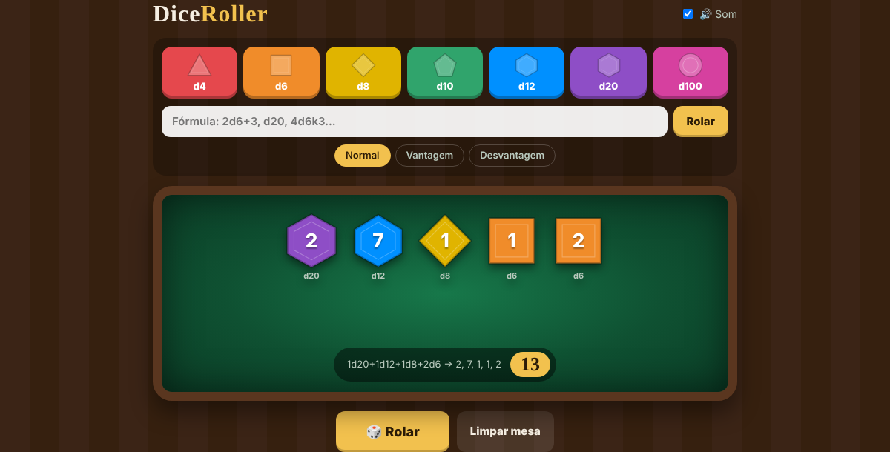

# DiceRoller — Rolador de dados

Role dados de 4 a 100 lados com animação, use fórmulas de RPG e acompanhe o histórico das jogadas.

🔗 **[Ver o site no ar](https://iamviniciuslima05.github.io/PROJETO-DiceRoller/)**



## Funcionalidades

- Dados **d4, d6, d8, d10, d12, d20 e d100**
- **Fórmulas** de RPG: 2d6+3, 4d6k3 (mantém os 3 maiores), 2d20kl1…
- **Vantagem e desvantagem** no d20
- **Segurar dados** para não rolar de novo
- Sorteio com **crypto.getRandomValues**, sem viés
- **Som** gerado no navegador e animação de rolagem
- **Histórico** com média, maior e menor resultado

## Tecnologias

HTML5 · CSS3 · JavaScript · SVG · Web Audio API · localStorage

## Estrutura

```
index.html
css/style.css
js/script.js
```

## Como rodar

Não precisa instalar nada: baixe o projeto e abra o `index.html` no navegador, ou acesse a versão publicada acima.

---
Feito por **Vinicius Lima** · [Portfólio](https://viniciuslimadev.netlify.app) · [LinkedIn](https://www.linkedin.com/in/viniciuslima25/)
